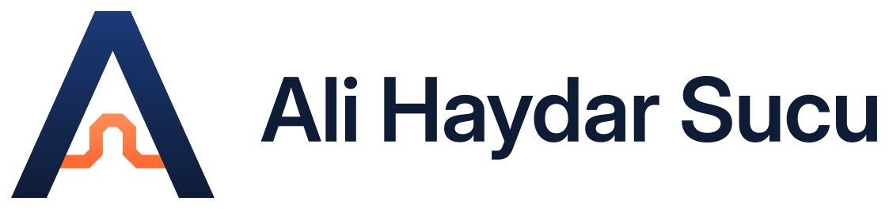

	<picture>
		<source media="(prefers-color-scheme: dark)" srcset="./logo-horizontal-dark.svg">
    
	</picture>

#  👋

3rd-year Computer Engineering student at Ankara Yıldırım Beyazıt University, focused on **Embedded AI & Autonomous Systems**.

I build intelligent systems that run close to the hardware: edge AI inference, RTOS-based firmware, and Linux-based robotics. My goal is to work as an **Embedded AI Engineer** in the defense industry.

🐧 Linux & open-source enthusiast
⚙️ Interested in edge AI, embedded platforms, and autonomous vehicles

<strong>🚀 Tech Stack</strong>

 
<table>
  <tr>
    <td align="center"><strong>Languages & Core</strong></td>
  </tr>
  <tr>
    <td align="center">
      
    </td>
  </tr>
  <tr>
    <td align="center"><strong>Tools & Platforms</strong></td>
  </tr>
  <tr>
    <td align="center">
      
    </td>
  </tr>
  <tr>
    <td align="center"><strong>AI & Edge ML</strong></td>
  </tr>
  <tr>
    <td align="center">
      
    </td>
  </tr>
  <tr>
    <td align="center"><strong>Embedded, Robotics & Simulation</strong></td>
  </tr>
  <tr>
    <td align="center">
      
      &nbsp;
      
      &nbsp;
      
      &nbsp;
      
      &nbsp;
      
      &nbsp;
      
      &nbsp;
      
    </td>
  </tr>
</table>

<strong>🎯 Goals</strong>

- Grow into an **Embedded AI Engineer** role in the Turkish defense sector
- Publish clean, well-documented repositories (README + schematics + explanations) for my STM32, RTOS, and Gazebo simulation work
- Share benchmark results and lessons learned from running LLMs on edge hardware
- Contribute to open-source projects (embedded, tooling, or AI infra)

 

